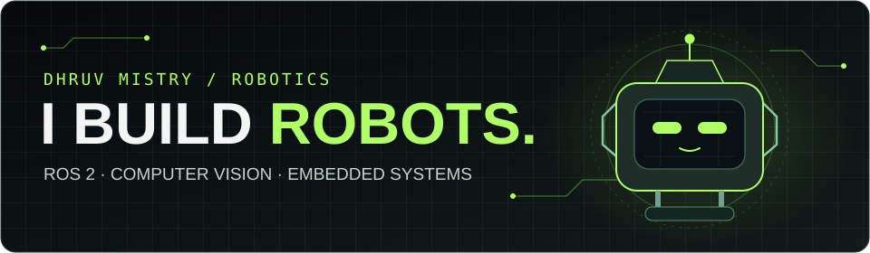

# Dhruv Mistry

**M.Sc. Intelligent Robotics · Deggendorf Institute of Technology**

I build mobile robot systems and test how they behave in simulation and on hardware. My current work focuses on ROS 2 navigation, perception, and embedded control.

[**Engineering portfolio**](https://dhruv-mistry-v4.dhruv301003.chatgpt.site/) · [**Portfolio auf Deutsch**](https://dhruv-mistry-v4.dhruv301003.chatgpt.site/de/) · [**LinkedIn**](https://www.linkedin.com/in/dhruv-mistry-09b833219/)

## Selected projects

- **[TurtleBot3 Navigation, Localization & Reactive Safety](https://github.com/RockingMan3010/turtlebot3-nav2-localization-safety)** — ROS 2 Humble and Nav2 in Gazebo. Compares wheel odometry with EKF-fused odometry and IMU while keeping AMCL in both setups. Includes measured plots and a separate simulated LiDAR stop/resume test. [Architecture](https://github.com/RockingMan3010/turtlebot3-nav2-localization-safety/blob/main/docs/architecture.md) · [Results](https://github.com/RockingMan3010/turtlebot3-nav2-localization-safety/blob/main/docs/results.md)
- **[RockingMan PiCar-Pro](https://github.com/RockingMan3010/RockingMan-PiCar)** — Raspberry Pi 5 companion robot experiments on the Adeept PiCar-Pro V2.0, including servo calibration and motion, gamepad teleoperation, and onboard status monitoring.

**Tools I work with:** ROS 2 · Nav2 · Python · Gazebo · OpenCV · Raspberry Pi
